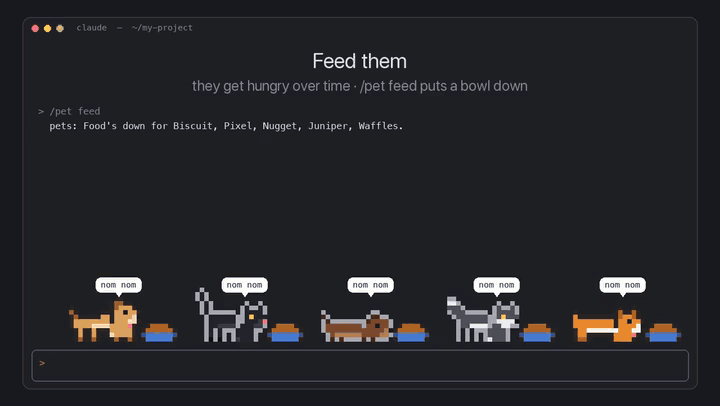
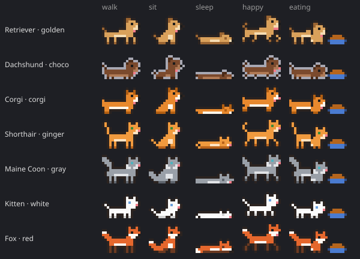

# 🐾 Pets for Claude Code

Pixel-art pets that live above your Claude Code prompt. They walk around while you work, get hungry, nap, wear hats, play fetch, throw a party when your tests pass, faint when they fail, react to the mood of the chat, and look *very* busy when your boss walks by.



▶️ [Watch the full 100-second demo](media/showcase.mp4)

---

## Install

You need **Claude Code 2.1.287 or newer**, which supports mods (`claude update` if you're not sure). In a Claude Code terminal session, type:

```
/plugin install pets --marketplace ekvirika/claude-code-pets
```

Answer `y` to add the marketplace and pick a scope (user scope gives you pets in every session). Biscuit the golden retriever shows up above your prompt right away. Pets also appear in the Code tab of the Claude desktop app. In a narrow terminal (under 120 columns) the pets shrink to half size automatically; `/pet size large` or `/pet size small` picks one for good.

## Quick start

```
/pet                          your pets, how hungry and tired they are, and all commands
/pet add cat kitten siamese Miso
/pet feed
/pet hat all party
/pet boss
```

Or just talk to them in the chat: **"who's a good boy"**, **"Biscuit sit"**, **"Pixel come here"**, **"everyone dance"**.

---

## What they do

### 🐕 3 animals, 7 breeds, 14 skins
- **Dogs:** retriever, dachshund, corgi
- **Cats:** shorthair, Maine Coon, kitten
- **Fox**

Every color skin fits every breed of its kind: golden, corgi, black lab, husky, chocolate and samoyed for dogs; ginger, black, gray, siamese and white for cats; red, arctic and silver for foxes. Up to 5 pets at once, remembered between sessions.



### 🍖 Needs
Pets get **hungry** over about two hours (they drag their paws and ask for food) and **tired** over about an hour (they yawn and nap by themselves). `/pet feed` puts a bowl down; they trot over, eat, and say "yum! ♥". After 2 idle minutes they curl up and sleep, breathing slowly. When you come back after time away, they've slept, but they're hungry.

### 🎉 They react to your work
- **Tests pass** → party hats for everyone
- **Tests fail** → one pet faints, legs in the air ("x_x"), the others call the vet
- **A commit succeeds** → "committed! 🎉"
- **While Claude works** → they run around; when it's done, they cheer

### 🫶 They read the room
A tiny AI check (one small Haiku call per message) reads the mood:

| You sound… | The pets… |
|---|---|
| frustrated | the two nearest come over: "it's okay", "bugs fear you" |
| sad | everyone huddles up: "*snuggles*" |
| angry | they hide |
| happy | party |
| grateful | hearts all round |
| excited | zoomies |
| confused | one tilts its head |

They also read **Claude's** replies: worried when it apologizes or hits an error, cheering on a success, and sitting patiently ("👀 your turn") when it asks you a question. `/pet moods off` turns the AI checks off.

### 🗣️ Talk to them
"good boy", "who's a good girl", "Biscuit sit", "Pixel come here", "Nugget roll over", "speak", "dance", "fetch", "nap", "treat", "everyone…". A short message that's only for the pets **isn't sent to Claude**, so it doesn't spend a turn. These are matched locally: instant and free.

### 🎩 Dress-up, games and sass
- **Hats:** party, crown, wizard, santa, top hat, plus shades and a bow tie (`/pet hat <name|all> <item>`)
- **Fetch:** `/pet ball`, and the nearest pet races for it
- **Antics:** random zoomies, games of tag
- **Sass:** canned one-liners about what Claude does ("another console.log? bold.", "force push on a Friday?"). Max one every 40 seconds; `/pet sass off` to mute. No AI calls.

### 🕴️ Boss mode
`/pet boss`: every pet puts on shades and a tie and sits at a tiny laptop, saying things like "per my last email…" and "let's circle back". `/pet boss off`: "phew! is he gone?"

---

## All commands

| Command | |
|---|---|
| `/pet` | roster with food and energy bars, plus help |
| `/pet add <dog\|cat\|fox> [breed] [skin] [name]` | adopt (any order) |
| `/pet feed [name\|all]` | put food down |
| `/pet sleep [name\|all]`, `/pet wake [name\|all]` | bedtime and wake-up |
| `/pet pat <name>` | a little love |
| `/pet hat <name\|all> <item\|none>` | dress up |
| `/pet ball` | throw a ball |
| `/pet zoomies [name\|all]` | go wild |
| `/pet party` | celebrate |
| `/pet boss [on\|off]` | look busy |
| `/pet sass on\|off`, `/pet moods on\|off` | comments and mood reactions |
| `/pet breed <name> <breed>`, `/pet skin <name> <skin>` | change looks |
| `/pet name <name> <new name>`, `/pet remove <name>` | rename, say goodbye |
| `/pet breeds`, `/pet skins`, `/pet hats` | list them all |
| `/pet size small\|large\|auto` | small pets (8×3) for narrow terminals; auto switches under 120 columns |
| `/pet off`, `/pet on` | hide or show the pets |

---

## How it works

This is a **Claude Code mod**: a plugin of function hooks that draws into Claude Code's own interface.

- A `ui.render` hook on the band above the prompt draws the pets. It draws *beneath* any band other mods show, never instead of it.
- In the terminal each sprite is a `Raster` of half-block characters (two pixels per cell, true color). In the desktop app it's a crisp SVG.
- `tool.call`, `turn.start`, `turn.complete` and `prompt.submit` hooks let the pets notice tests, commits, your mood and Claude's.
- All state is local. The only network traffic is the optional mood check, which goes through Claude Code's own model client and counts toward your normal Claude usage.

```
hooks/register.tsx   commands, hooks, drawing
hooks/life.ts        the behavior engine: needs, moods, walking, eating, napping
hooks/sprites.ts     16×12 sprites, breeds and skins
hooks/accessories.ts hats, shades, ties, laptops
hooks/moods.ts       mood reactions and pet talk
hooks/sass.ts        reactions to Claude's actions
tests/               run with `claude plugin test .`
```

## Make your own pet

Sprites are plain text, 16×12, facing right. Each letter is a palette slot a skin fills in:

```
B body   D dark (ears, paws)   L light (belly, muzzle)
E eye    N nose   P pink (tongue)   H heart (optional, it beats)   . empty
```

Add frames for `walk` (×2), `sit`, `sleep` and `happy` in `hooks/sprites.ts`, register them with `breed(...)` in `BREEDS`, and add skins in `SKINS`. Eating, blinking, breathing, hopping, fainting and hats are derived automatically. A skin with `mono: true` and its own outline `O` draws its hats and props in its two colors only, which makes a strict black-and-white brand pet possible.

Then `claude plugin validate .` and `claude plugin test .`. PRs with new animals are very welcome 🐰🐼🦆

---

Made by [Elene Kvirikashvili](https://github.com/ekvirika) with Claude Code. MIT licensed.
